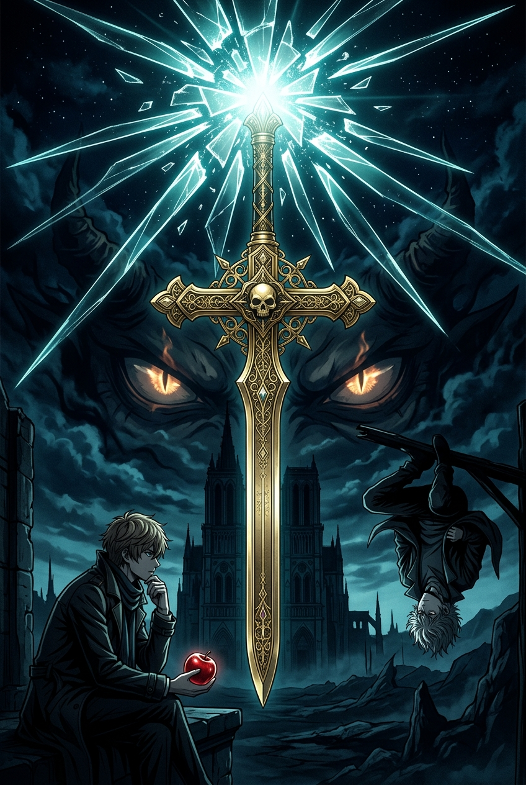

# دفتر الظل — Shadow Ledger 📓⚖️

> **لعبة استنتاج نفسي وصراع فكري بين كيرا (Kira) والمحقق L مستوحاة من أسطورة مذكرة الموت (*Death Note*).**



---

## 🌟 نظرة عامة (Overview)

**دفتر الظل (Shadow Ledger)** هي لعبة استراتيجية وتكتيكية نفسية تحاكي صراع العقول بين العبقرية المطلقة والعدالة الصارمة. يمكنك اللعب بشكل فردي ضد الذكاء الاصطناعي (باختيار إما دور **كيرا** أو دور **المحقق L**)، أو خوض نزال مباشر أونلاين (1v1) عبر تقنية PeerJS.

---

## 🎮 أسلوب اللعب (Gameplay Modes)

### 1. اللعب كـ كيرا (Play as Kira)
- **دفتر الموت التفاعلي:** اكتب أسماء الأهداف الجنائية الموثقة بملفات الشرطة واستحضر وجوههم.
- **تحديد أسباب الوفاة:** اختر بين النوبة القلبية المباغتة، الحوادث المدبرة، أو المرض لتشتيت مسار التحقيق الجنائي.
- **إدارة الشبهة والوقت:** خطط لساعات تنفيذ الأحكام بحذر لتفادي تحليل L الزمني لنمط نومك ونشاطك.
- **صفقة أعين الشينيغامي:** خفض نصف عمرك لكشف الهويات الحقيقية فوراً.

### 2. التحقيق كـ المحقق L (Play as Detective L)
- **خريطة التوزيع البايزي (Bayesian Heat Map):** رادار تكتيكي يحلل النمط الجغرافي للجرائم ويحصر إقامة كيرا تدريجياً بين قطاعات العاصمة (الشمال، الغرب، الوسط، الشرق، الجنوب).
- **العمليات التكتيكية والفخاخ:**
  - 📺 **بث الطُعم التلفزيوني (Decoy Broadcast):** إعلان خبر مجرم وهمي في قطاع معين؛ إذا قتله كيرا، يُكشف موقعه فوراً.
  - 📹 **تشديد المراقبة والكاميرات (CCTV):** رصد تحركات المشتبه بهم لرفع دقة الرادار.
  - 🎙️ **فخ ليند إل. تايلور الحي (Lind L. Tailor):** الاستفزاز النفسي الأكبر؛ تحدي مباشر على الهواء يدفع كيرا للقتل الفوري.
  - 🚨 **المداهمة الحاسمة (Raid):** إصدار أمر القبض ومداهمة مقر كيرا السري متلبساً.

### 3. مبارزة الأقران أونلاين (1v1 Online Duel)
- غرف خاصة ورموز غرف مشفرة عبر **PeerJS / WebRTC**.
- **الشات النفسي المباشر (Psychological Mind-Game Chat):** استفزازات كتابية مع مؤثرات صوتية وتشفير للصوت تحاكي غرف استجواب L.

---

## 🛠️ التقنيات المستخدمة (Tech Stack)

- **الواجهة:** React 19 + TypeScript
- **أداة البناء:** Vite
- **التصميم:** Modern Dark Glassmorphism + Responsive Vanilla CSS (محسّن للموبايل، التابلت، والشاشات العريضة)
- **محرك الصوت الإجرائي:** Web Audio API (توليد أصوات الرعد، المطر، التشويش اللاسلكي، ضربات القلب، وصوت L بدون ملفات خارجية ثقيلة)
- **منصات الهواتف المحمولة:** Capacitor 8 (دعم كامل لـ Android مع Gradle 8.11.1 و iOS)
- **تطبيقات سطح المكتب:** Electron

---

## 🚀 التشغيل محلياً (Getting Started)

### المتطلبات الأساسية
- [Node.js](https://nodejs.org/) (الإصدار 18 أو أحدث)
- npm أو pnpm أو yarn

### خطوات التثبيت والتشغيل:

1. **استنساخ المستودع (Clone the repository):**
   ```bash
   git clone https://github.com/USERNAME/shadow-ledger.git
   cd shadow-ledger
   ```

2. **تثبيت الحزم (Install dependencies):**
   ```bash
   npm install
   ```

3. **تشغيل خادم التطوير (Run dev server):**
   ```bash
   npm run dev
   ```
   افتح المتصفح على: `http://localhost:5174/` أو الرابط الموضح في الطرفية.

4. **بناء نسخة الإنتاج (Production Build):**
   ```bash
   npm run build
   ```

5. **تشغيل أندرويد (Android Studio):**
   ```bash
   npm run cap:sync
   npm run cap:android
   ```

---

## 📜 الترخيص (License)
هذا المشروع مطوّر لأغراض برمجية وترفيهية وتجربة استنتاجية نفسية خاصة.
جميع الحقوق محفوظة للمطور.
